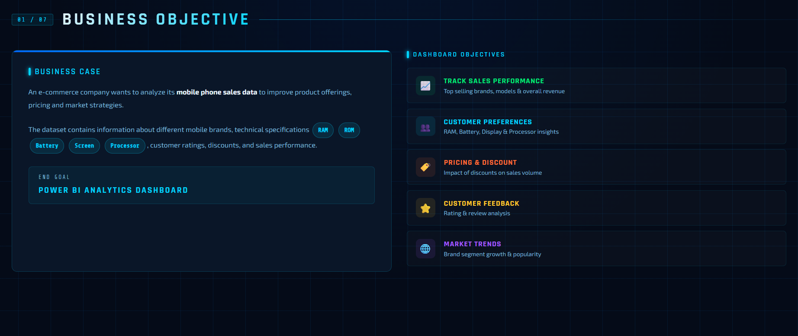
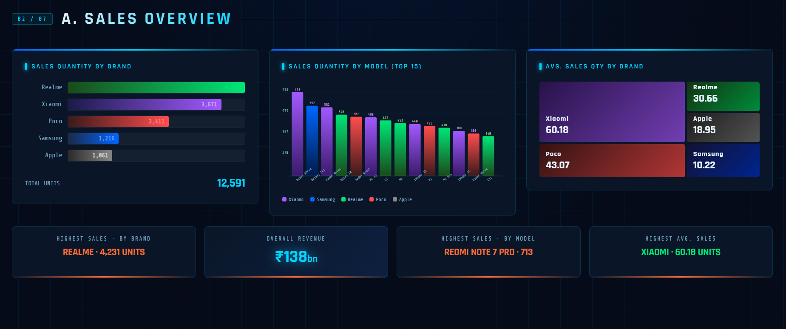
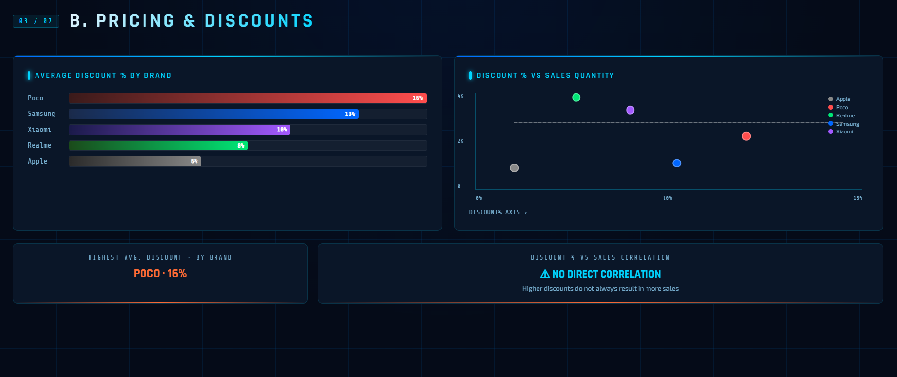
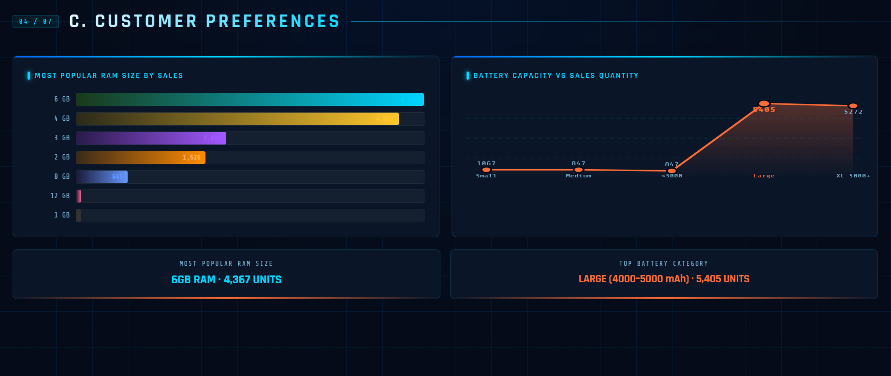
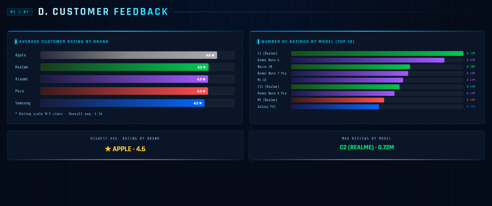
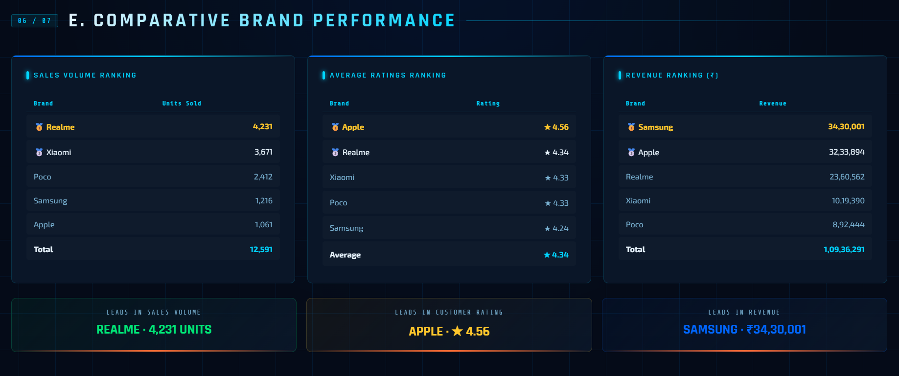
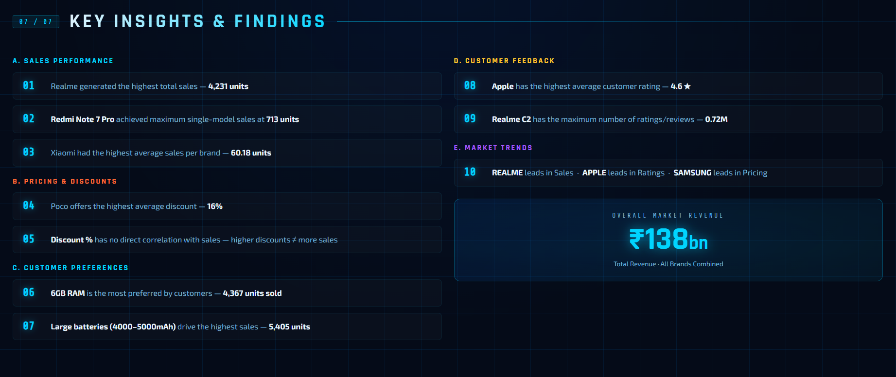

# Mobile-Sales-Dashboard-Power-BI
Interactive Mobile Sales Dashboard using Power BI
# 📱 Mobile Sales Dashboard | Power BI

## Project Overview
This project presents a Mobile Sales Dashboard developed using Microsoft Power BI to analyze mobile sales performance and customer purchasing patterns.

## Tools & Technologies
- Microsoft Power BI
- Power Query
- DAX
- Data Visualization
- Generative AI (visual design assistance)

## Key Features
- Total Sales Analysis
- Monthly Sales Trends
- Brand-wise Sales Analysis
- Mobile Model Performance
- City-wise Sales Analysis
- Payment Method Analysis
- Customer Rating Analysis

## Project Objectives
- Analyze mobile sales performance.
- Identify monthly sales trends.
- Compare different mobile brands.
- Understand customer purchasing behavior.
- Present business insights through visualizations.

## Dashboard Screenshots

### Dashboard View 1

### Dashboard View 2

### Dashboard View 3

### Dashboard View 4

### Dashboard View 5

### Dashboard View 6

### Dashboard View 7

## AI Assistance
AI tools were used to assist with improving the dashboard's colour scheme and visual presentation.

## Author
Vandana Joshi

Data Analytics | Power BI | Excel | SQL | Python | Generative AI
